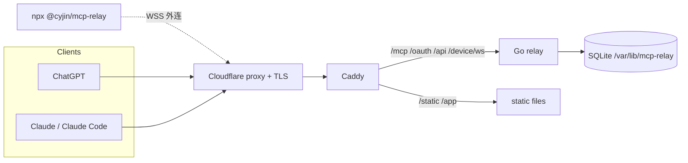

# mcp-relay — 实施记录与计划

状态（2026-11-22）：M0–M4 已部署；M5（Proto-UI 控制台）进行中。

## 1. 形态

- 公开端点：`https://relay.cyjin.dev/mcp`（Streamable HTTP，JSON 响应，无 SSE）。
- OAuth 2.1 AS 同域：`/.well-known/oauth-protected-resource`、
  `/.well-known/oauth-authorization-server`、`/oauth/{authorize,token,register,revoke}`。
- DCR（`none` / `client_secret_post` / `client_secret_basic`）+ PKCE S256 + RFC 9207 `iss` +
  `resource` audience 绑定。CIMD 代码保留但不再 advertise，以避开 claude.ai 的抓取挑战。
- 设备：网页一次性配对码 → `npx @cyjin/mcp-relay` 换长期设备 token → WSS 外连；
  文件与命令只在设备执行，relay 不接触文件内容。
- 多租户：同一 URL；token/设备/审计按 `user_id` 隔离；邀请码开放注册。

## 2. 工具面

内置：`devices_list`（relay.read）。

设备（在线时出现，`d_<slug>__<tool>`）：

- `minimal`：`read` `write` `edit` `bash` `grep` `find` `ls`
- `omp`：`omp_read` `omp_hash` `omp_apply_patch`（`*** Begin Patch` + expected SHA-256）
  `omp_glob` `omp_grep` `omp_ast_grep`（需 ast-grep）
- 搜索优先 `rg`，回退到有界 JS 扫描；`kernel` 持久 code mode 尚未发布。

scope：`readOnlyHint=true` → `relay.read`；其余 → `relay.write`。`tools/list` 需要 `relay.read`。
写工具在 ChatGPT 默认需要确认。

## 3. 安全不变量

- OAuth：code 60s 一次性；PKCE S256；refresh 轮换 + family 复用撤销；
  audience 必须是 `https://relay.cyjin.dev/mcp`；access token 不透明、1h。
- DCR：客户端注册限速 20/h/IP；public `none`、`client_secret_post` 或 `client_secret_basic`；
  redirect_uris 只允许 https 或 loopback http。CIMD 抓取仅保留为未 advertise 的兼容路径。
- 设备：token 只用于 WSS，不能调 MCP；配对码 8 字符、哈希、一次性、10 分钟；
  设备按用户过滤，跨用户不可见/不可撤销。
- 设备文件工具：路径 realpath 后必须仍在 `--root`；glob 拒绝 `..`/绝对模式；
  只读普通文件；patch 先校验全部 base hash 再写，失败回滚；重复路径拒绝。
- bash：过滤环境、独立进程组、超时 kill、stdout/stderr 各 64 KiB。
- Web：`__Host-mrl_session`、CSRF（Origin + 常量时间 token）、CSP、`no-store`、
  审计不记录参数原文。
- 代理：Caddy 覆写 `CF-Connecting-IP`，Go 只在 loopback/私网 upstream 时信任它。
- 限流：DCR 20/h/IP、配对/邀请 10/h/IP、OAuth 300/min/IP、MCP 120/min/token。
- 每小时 `store.Prune()` 清理过期会话/授权码/token/30 天前审计。

## 4. 部署（OVH Debian 13）

- `/usr/local/bin/mcp-relay`（Go 静态二进制，systemd `mcp-relay`）
- `/etc/mcp-relay/env`（600；`BASE_URL`、GitHub OAuth、ADMIN_GITHUB_LOGIN）
- `/var/lib/mcp-relay/relay.sqlite`（WAL，700 目录）
- Caddy：`relay.cyjin.dev` 反代 `127.0.0.1:8080`；`/static` 与 `/app` 静态；
  证书由 certbot DNS-01（Cloudflare token）签发到 `/etc/caddy/certs`，deploy hook 复制并 reload。
- Cloudflare：`relay` A → <OVH_PUBLIC_IPV4>，橙色云；`ovh.cyjin.dev` 保持原静态站。
- SSH 经 TNA 跳板：`ssh -J root@<TNA_JUMP_HOST> root@<OVH_PUBLIC_IPV4>`。
- 回滚：停 Caddy、恢复 nginx；Go 服务独立，可单独停。

## 5. 已完成

- [x] Go OAuth AS + discovery + GitHub 登录 + 邀请 + 会话/CSRF
- [x] MCP endpoint、`devices_list`、scope 强制、审计
- [x] WSS 设备注册、心跳、重连、工具路由、配对
- [x] 设备 CLI：minimal + omp + rg/ast-grep、路径约束、patch 哈希
- [x] npm `@cyjin/mcp-relay@0.1.0`（0.1.1 含硬化修复）
- [x] OVH + Caddy + Cloudflare 部署；生产 WSS/MCP 端到端验证
- [x] life keyring 存入 GitHub OAuth 与 npm token；credential records 已提交
- [x] Go/TS 测试：OAuth、refresh 重放、scope、跨用户、patch、glob 逃逸

## 6. 待办

- [ ] Proto-UI 0.3.0-alpha.1 **Web Components + shadcn Rhea** 控制台（`web/`，`/app/`）
- [ ] 控制台内的 ChatGPT/Claude 接入说明（服务端 dashboard 已有简版）
- [ ] 生产浏览器验证：配对码 → 设备在线 → ChatGPT/Claude 完成 OAuth
- [ ] `@cyjin/mcp-relay@0.1.1` 注册表可见性确认
- [ ] kernel pack（持久 code mode，默认关闭）
- [ ] 备份定时任务（SQLite `.backup`）与监控

## 7. 关键约束

- 不使用 Proto-UI base/React；控制台使用 shadcn 原型 + Web Components adapter。
  `@proto.ui/compiler` 是 private、无发布 profile、CLI 无 compile 命令，因此不采用 compiler-based。
- 认证/同意页保持服务端 HTML（安全、零 JS）；控制台是独立静态 SPA。
- 不读写 `ogd-mcp` 或任何其他人的 tmux/服务；本项目数据只在
  `/tank/shared/projects/mcp-relay` 与 OVH `/var/lib/mcp-relay`。
